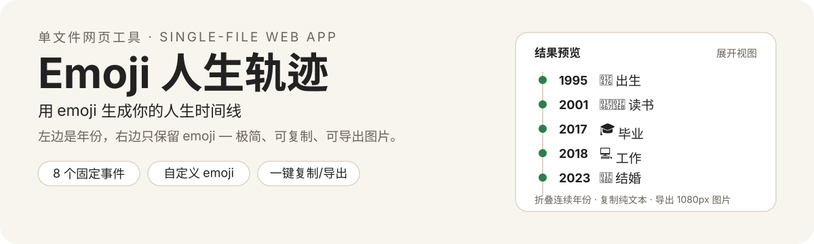
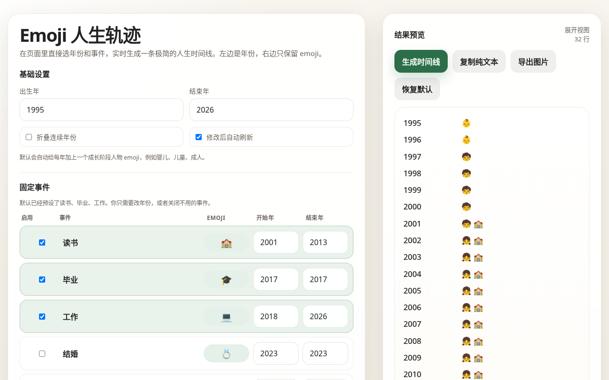

<p align="right"><a href="README.md">中文</a></p>

<p align="center">
  
</p>

<p align="center">
  <a href="https://xiaosang.cc/emoji-life/">▶ Live Demo</a>
  ·
  <a href="https://github.com/holynova/emoji_life">GitHub Repository</a>
</p>

Emoji Life Timeline is a single-file web app that generates your life timeline with emojis: enter your birth year and end year, pick years and events, and a minimalist timeline renders live — years on the left, only emojis on the right. Each year automatically gets a growth-stage person emoji by age; 8 preset events (school, graduation, work…) can be re-dated or disabled, and custom emoji events can be added.

## Screenshot

<p align="center">
  
</p>

## Features

- **Growth-stage emojis**: each year auto-gets a person emoji by age — 👶 (0–1), 🧒 (2–6), 👧 (7–17), 🧑 (18–25), 👩 (26+).
- **8 preset events**: 读书 school 🏫 (birth +6–18), 毕业 graduation 🎓 (+22), 工作 work 💻 (+23–), 结婚 marriage 💍 (+28), 买房 house 🏠 (+30), 养狗 dog 🐶 (+31–), 养猫 cat 🐱 (+32–), 生宝宝 baby 👶 (+33). Only school, graduation and work are on by default; every event's years can be edited or disabled.
- **Custom emoji events**: emoji only, single year or year range; ships with two examples (📚 2018–2020, 🐶 2025–2026).
- **Emoji bank**: 24 common emojis, click to copy into custom events.
- **Collapse / expand**: consecutive years with identical emojis fold into one row.
- **Copy & export**: one-click plain-text copy as `year + emoji`; Canvas-rendered 1080px PNG export (`emoji-life.png`, 2× pixel ratio) titled 「Emoji 人生轨迹」 ("Emoji Life Timeline").
- **Auto-save**: everything persists in localStorage; one-click reset to defaults.

## Run Locally

The whole site is a single `index.html` — zero dependencies, no build step. Just double-click to open it, or serve it statically:

```bash
python3 -m http.server 8000
# Open http://127.0.0.1:8000
```

## Tech

- Single-file app: HTML + CSS + JS all in `index.html` (~32KB), with no external dependencies or network requests.
- State: `localStorage` key `emoji-life-single-file-v1`; export is drawn with native Canvas (no screenshot library).

```
index.html                  The whole site: form + timeline rendering + copy + Canvas export
.github/workflows/deploy-pages.yml   GitHub Pages auto-deploy
```
