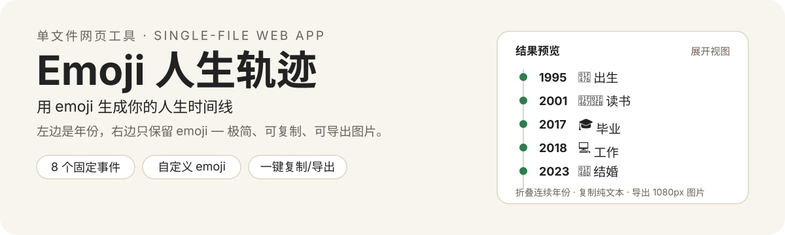
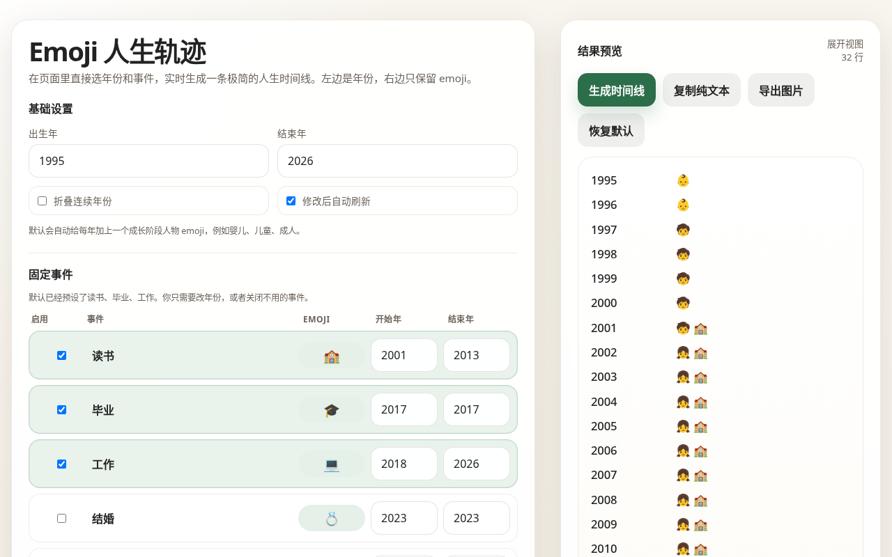

<p align="center">
  
</p>

<p align="center">
  <a href="https://xiaosang.cc/emoji-life/">▶ 在线体验 Play Online</a>
  ·
  <a href="https://github.com/holynova/emoji_life">GitHub 仓库</a>
</p>

Emoji 人生轨迹是一个单文件网页工具，用 emoji 生成你的人生时间线：填出生年和结束年，选年份和事件，实时生成一条极简时间线——左边是年份，右边只保留 emoji。默认会按年龄给每年加上成长阶段人物 emoji，读书、毕业、工作等 8 个固定事件可改年份或关闭，也能加自定义 emoji 事件。

Emoji Life Timeline is a single-file web app that generates your life timeline with emojis: enter your birth year and end year, pick years and events, and a minimalist timeline renders live — years on the left, only emojis on the right. Each year automatically gets a growth-stage person emoji by age; 8 preset events (school, graduation, work…) can be re-dated or disabled, and custom emoji events can be added.

## 截图 / Screenshot

<p align="center">
  
</p>

## 功能 / Features

- **成长阶段 emoji**：按年龄自动给每年加上人物 emoji——0–1 岁 👶、2–6 岁 🧒、7–17 岁 👧、18–25 岁 🧑、26 岁+ 👩。
- **8 个固定事件**：读书 🏫（出生 +6~+18 年）、毕业 🎓（+22）、工作 💻（+23 起）、结婚 💍（+28）、买房 🏠（+30）、养狗 🐶（+31 起）、养猫 🐱（+32 起）、生宝宝 👶（+33）。默认只启用读书、毕业、工作；每个事件可改起止年份或关闭。
- **自定义 emoji 事件**：只填 emoji，可设单年或起止年份；默认带两条示例（📚 2018–2020、🐶 2025–2026）。
- **常用 emoji 库**：24 个常用 emoji 点按即复制，方便粘贴到自定义事件里。
- **折叠连续年份**：相同 emoji 的连续年份可折叠成一行 / 展开。
- **一键复制纯文本**：把时间线复制为 `年份 + emoji` 的纯文本。
- **导出图片**：Canvas 手绘导出 1080px 宽 PNG（`emoji-life.png`，2 倍像素比），标题「Emoji 人生轨迹」。
- **自动保存**：所有设置存 localStorage，刷新不丢失；可一键恢复默认。

## 本地运行 / Run Locally

整站只有一个 `index.html`，零依赖、零构建，直接双击打开即可；或起静态服务器：

```bash
python3 -m http.server 8000
# 打开 http://127.0.0.1:8000
```

## 技术 / Tech

- 单文件应用：HTML + CSS + JS 全在 `index.html`（约 32KB），无任何外部依赖与网络请求。
- 状态管理：`localStorage` 键 `emoji-life-single-file-v1`；导出用原生 Canvas 绘制（非截图库）。

```
index.html                  整站：表单 + 时间线渲染 + 复制 + Canvas 导出
.github/workflows/deploy-pages.yml   GitHub Pages 自动部署
```

## English

**Emoji Life Timeline** is a single-file web app that turns your life into an emoji timeline: years on the left, only emojis on the right.

- **Growth-stage emojis**: each year auto-gets a person emoji by age — 👶 (0–1), 🧒 (2–6), 👧 (7–17), 🧑 (18–25), 👩 (26+).
- **8 preset events**: school 🏫 (birth +6–18), graduation 🎓 (+22), work 💻 (+23–), marriage 💍 (+28), house 🏠 (+30), dog 🐶 (+31–), cat 🐱 (+32–), baby 👶 (+33). Only school, graduation and work are on by default; every event's years can be edited or disabled.
- **Custom emoji events**: emoji only, single year or year range; ships with two examples (📚 2018–2020, 🐶 2025–2026).
- **Emoji bank**: 24 common emojis, click to copy into custom events.
- **Collapse / expand**: consecutive years with identical emojis fold into one row.
- **Copy & export**: one-click plain-text copy; Canvas-rendered 1080px PNG export (`emoji-life.png`, 2× pixel ratio).
- **Auto-save**: everything persists in localStorage; one-click reset to defaults.
- **Tech**: one `index.html` (~32KB), zero dependencies, zero network requests.
